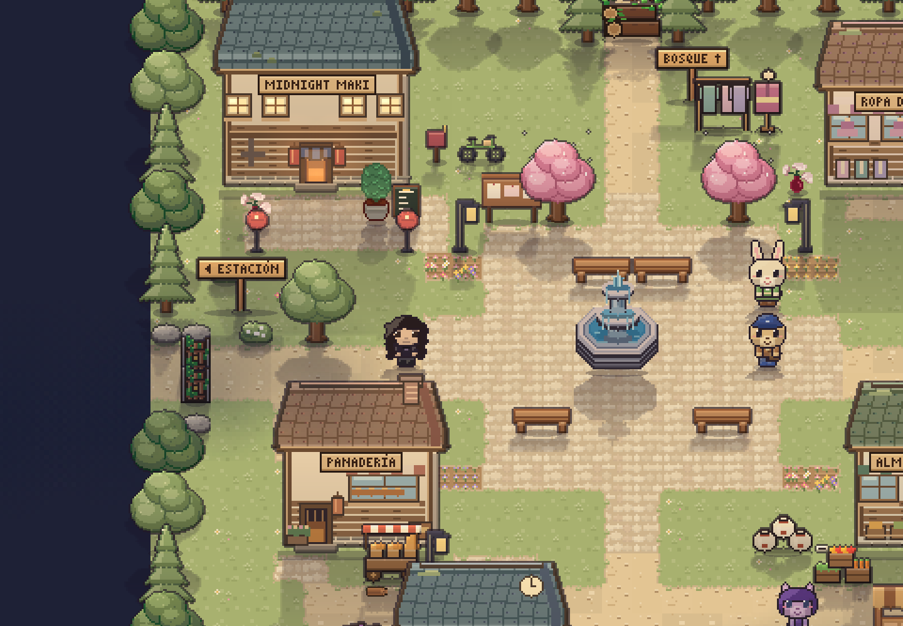
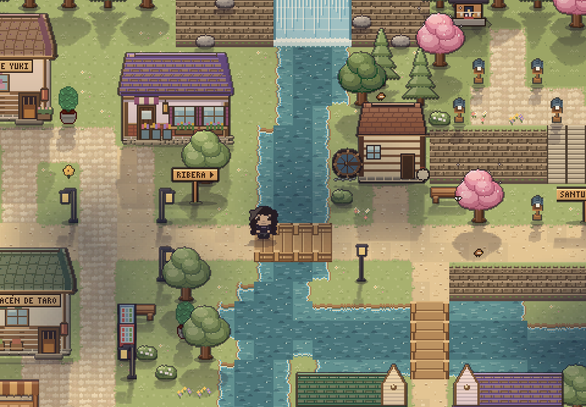
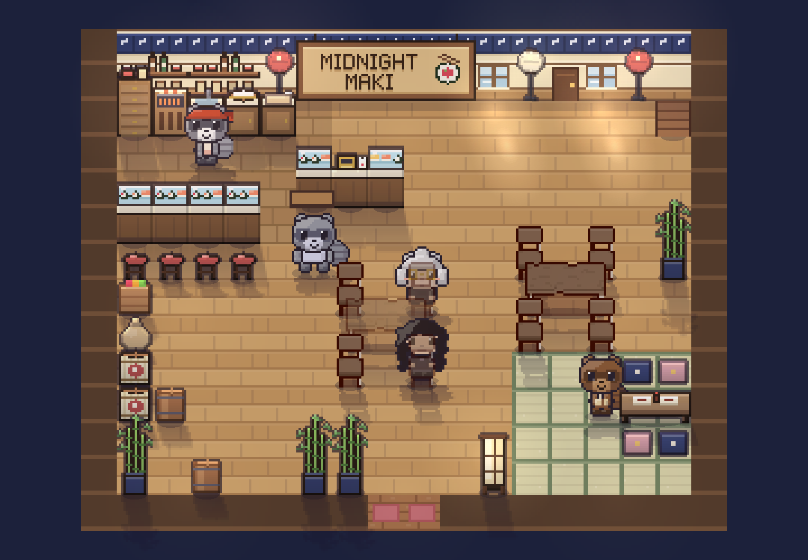

# Exterior cozy y selección de muebles

La continuidad con el restaurante se trabaja con césped verde claro cálido, tierra miel, caminos crema, piedra beige y agua azul verdosa. Se mantienen los mapas, accesos, puntos de recolección, cultivos y rutas de los personajes.

## Piezas incorporadas

- Demo VectoRaith: un recorte de césped, material de tejas adaptado a tres colores, arbusto redondo y farol japonés.
- Bitglow: mesa horizontal, cuatro vistas de silla, plantas, macetas, lámpara de pie, jarrón y reloj.
- Casas: las tejas importadas se repiten dentro de sus siluetas originales. Se aclara la madera y se conservan las posiciones de puertas y ventanas para las interacciones y luces.
- Puentes: tablones dorados y barandas con postes, construidos en el renderizador propio y con extremos abiertos sobre las mismas celdas transitables.
- Las casas, arcos, castillos y puentes de la imagen del pack completo que no están en la demo no se presentan como contenido extraído del ZIP.

Se agrupan 17 recortes en un atlas de 256×256 de aproximadamente 4 KB. Se carga al arrancar y se usa al generar texturas; los dibujantes procedurales quedan como alternativa si falta una pieza. No se precargan los paquetes completos ni sus copias ampliadas.

Mesas y sillas se ajustan con escala uniforme, sin cambiar sus huellas. La mesa horizontal se adapta al lienzo existente; la girada mantiene su dibujo propio. Las sillas pasan de 18 a 24 píxeles de altura visual y la maceta alta exterior a 32; los tamaños lógicos permanecen iguales.

Los permisos y fuentes de los recortes están en [créditos de recursos](asset-credits.md), y los autores aparecen también en el menú de créditos del juego.

## Capturas

[Galería del juego real](art/exterior-cozy/index.html).

## Verificación

Se comprueban TypeScript/build, la suite unitaria completa, la carga del atlas y las orientaciones de silla en navegador, los ciclos de luz y agua, lluvia, modo batería y movimiento reducido. Se revisan capturas de restaurante, plaza, casas, puentes, jardín, bosque, costa y móvil.

La escena de verificación nocturna del agua se sitúa en el minuto 40: en el minuto 10 la luna todavía está ascendiendo y su reflexión queda por debajo de la expectativa de plena noche del test. No se modifica la curva de luz lunar para resolverlo.

Respaldo previo: `respaldo/antes-exterior-cozy-2026-10-16`, en `28b97af39aa5cbeb581ea3704367ba2ba3a28803`.
