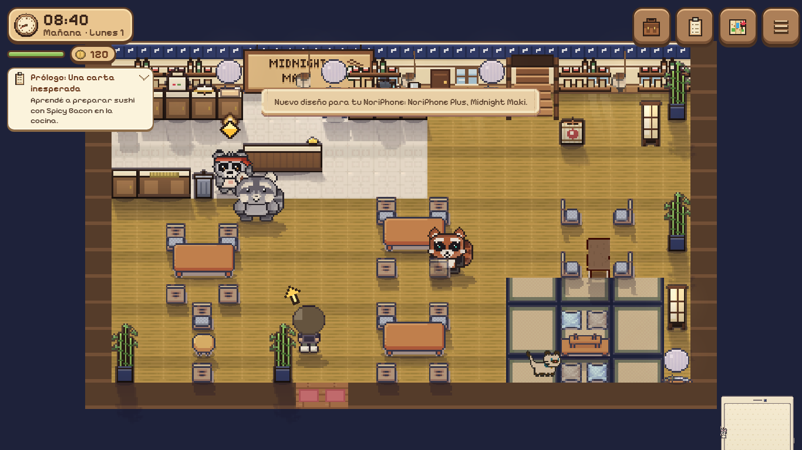
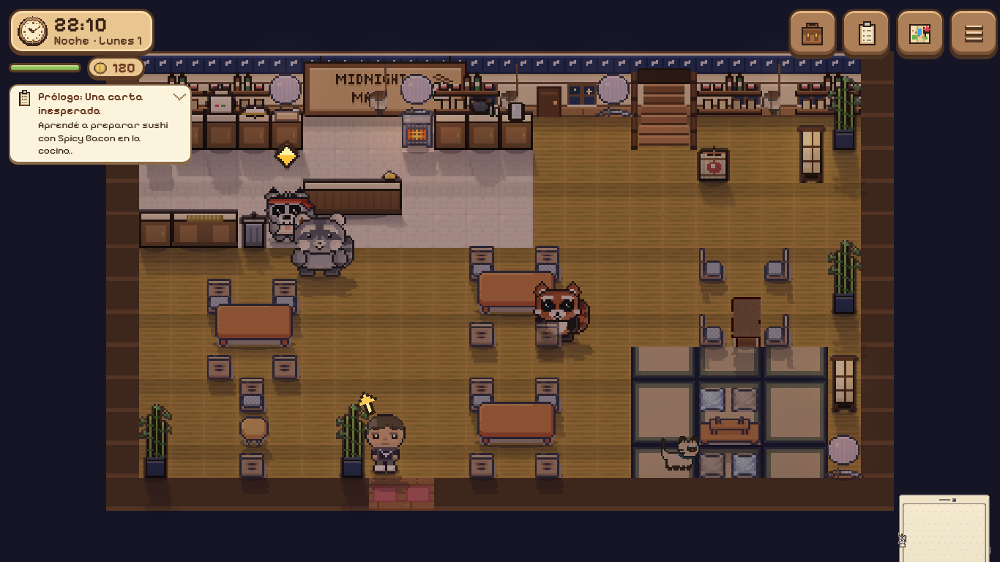

# Restaurante, personajes e iluminación interior

Base comprobada: `7dc1120`, última revisión publicada de `master-mgsshv` al iniciar.
La copia anterior tenía otro historial; se conserva íntegra en la rama local
`respaldo-local-antes-7dc1120`. No se mezclaron ni reemplazaron los sistemas nuevos
del pueblo con las versiones anteriores.

## Etapa 1: salón planificado

Mesa principal desplazada hacia el centro, mesa longitudinal junto a las ventanas
orientada de lado, rincón de tatami delimitado a la derecha. Las ampliaciones
completan el salón izquierdo y el sector inferior sin bloquear la entrada central.
Menos barriles; un andon acompaña el tatami y otro la zona de escaleras.
Se mantienen la cocina física, sus estaciones y tiempos, entrada, recepción de
Pip, escaleras, depósito cerrado por historia, niveles y mejoras.

`restaurant/interiorLayout.ts` centraliza los conjuntos iniciales y la primera
ampliación. Una migración idempotente conserva UIDs, rotaciones y propiedad:
solo mueve conjuntos originales completos si el destino está libre. No elimina
muebles ni vacía inventarios. Si alguien personalizó un conjunto, o el nuevo
sitio está ocupado, queda donde estaba. Una partida con servicio activo difiere
la migración hasta una visita posterior. Las siguientes ampliaciones conservan
su lógica de enviar los muebles al depósito cuando no hay sitio.

## Etapa 2: apariencias antiguas

Los vecinos Ren, Mika, Haru, Tomo, Nene, Goro, Fuyu, Sato, Mame, Kai, Rin y Oto,
y las apariencias usadas por extras/vendedores, pasan del chibi antiguo al mismo
renderer `folk` de los personajes principales. `art/neighborArt.ts` adapta las
apariencias guardadas: conserva pelaje, pelo, vestimenta, accesorios y especie;
elige orejas, hocico y cola correspondientes. Las hojas conservan 30 cuadros y
se informa su tamaño y margen reales a Actor. Caché con clave nueva para evitar
reutilizar una hoja antigua de otras dimensiones; retratos de respaldo coherentes.

Sofi, los mapaches, comerciantes principales y los clientes detallados ya tenían
el estilo actual: se conservan. No se modifican sus IDs, historias, casas,
amistades, rutinas, diálogos ni actividades. Tampoco se modifica el editor de
apariencias de los jugadores.

## Etapa 3: luz interior

`scenes/interiorLight.ts` calcula intensidad, tono, inclinación y longitud de la
proyección a partir del reloj existente, con continuidad entre períodos. Las
franjas parten de las ventanas reales del mapa y muestran la separación de sus
paneles. Pierden intensidad con lluvia y desaparecen durante la noche. La
proyección termina ante paredes y obstáculos altos; la sombra de corte es simple.

Las lámparas interiores tienen radios menores y la noche menos luz uniforme.
Los aportes de luz de la capa multiplicativa se limitan al suelo interior. Se
mantienen las sombras existentes de actores/objetos, halos y fuentes de luz.
La penumbra sigue en el canvas pequeño con caché: el titileo no invalida esa capa.
La luz solar también usa caché y se invalida por hora cuantizada, clima, calidad
o decoración, incluyendo escenas pausadas al entrar.

## Validación única al final de las tres etapas

- `npx tsc --noEmit` y `npm run build`: correctos.
- Vitest acotado: `diningComfort`, `interiorRedesign`, `floor`, `light`, `storage`:
  **89 pruebas correctas**. Se actualizan las coordenadas del layout antiguo en
  los tests existentes; se conserva la intención de colisiones y migraciones.
- Cuatro etapas: 3/4/5/6 mesas con capacidad positiva, asientos alcanzables y
  rutas hacia recepción, cocina, escaleras y depósito. Se verifican conservación
  de UIDs/inventario, migración repetida, destino ocupado y servicio activo.
- Playwright Chromium, `/?debug`, `perf: 'high'`: 34 capturas. Cuatro etapas,
  restaurante, planta de habitaciones, biblioteca, tres tiendas y faro en cuatro
  períodos; lluvia y vista vertical 412×915, además de PC 1366×768. Galería de
  vecinos de frente/espalda. Capturas inspeccionadas; sin errores JavaScript.
- Escena quieta, 60 llamadas: oscuridad **100 → 100**, solar **63 → 63** redibujos.
  Registro y capturas adicionales en `/workspace/exports/interiores-7dc1120/`.
- Packs privados descargados en su carpeta ignorada: revisión con el arte real,
  sin publicar los archivos originales de los packs.

No se ejecutó la suite completa, ni se probó en teléfono físico o Android nativo.
La oclusión es conservadora (corta la franja frente a muebles altos); no simula
reflejos, alturas 3D o sombras exactas para cada mueble. Se comprobó la circulación
con rutas y el sistema de mesas, no una jornada completa de servicio manual.
No se cambian vegetación, fauna, música ni interacciones ambientales exteriores.

Archivos de implementación: `data/zones.ts`, `restaurant/interiorLayout.ts`,
`restaurant/stages.ts`, `world/zoneRuntime.ts`, `art/neighborArt.ts`,
`scenes/textures.ts`, `systems/appearance.ts`, `scenes/interiorLight.ts`,
`scenes/lightmath.ts`, `scenes/WorldScene.ts`. Pruebas: `diningComfort.test.ts` e
`interiorRedesign.test.ts`; las demás pruebas relevantes se reutilizan.
La máscara de cada lámpara se limita también por las paredes de su habitación,
mediante cuatro recorridos cortos sobre la grilla; no ilumina uniformemente el
cuarto vecino a través de un tabique.

Comprobación adicional en navegador: la misma apariencia animal produce 20×30
para jugador local/remoto (su renderer anterior) y 30×39 para NPC, con 30 cuadros
válidos. La actualización de vecinos no modifica el aspecto de avatares guardados.
