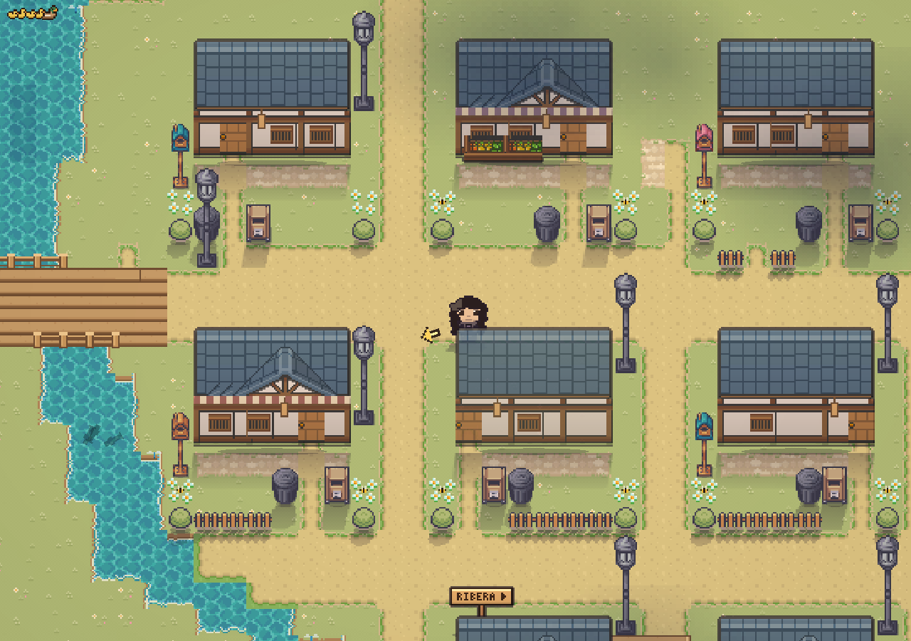

# Villa Nori como un solo mapa

02/11/2026. El exterior del pueblo dejó de ser nueve zonas que se cargaban de a una: ahora es **un solo mapa vivo de
120×80 casillas** con todos los barrios a la vez (plaza, bosque, jardín, playa, santuario, estación, residencial,
mercado y puerto). Caminar de un barrio a otro no recarga nada: es seguir por la calle. Solo los interiores (locales,
restaurante, casas, faro, depósito) y el Bosque profundo siguen siendo lugares aparte, con su puerta y su fundido.

## Cómo está armado
- `src/world/village.ts` arma el mapa: construye cada barrio **exactamente igual que antes** (mismas baldosas, bordes,
  objetos y condiciones) y los pega en su lugar del mundo. No se registra en `ZONES`, así las búsquedas de datos
  ("¿en qué zona está esta interacción?") siguen respondiendo con el barrio.
- Las puertas que había en los bordes entre barrios desaparecen: son calle. Un barrio **todavía cerrado** (candado de la
  historia: bosque, jardín, playa, estación) tiene su borde como pared hasta que se abre, igual que antes; el cartel de
  "Camino cerrado" sigue funcionando.
- **El barrio sigue siendo la identidad**: misiones, rutinas de los vecinos, el guardado y la historia siguen hablando de
  "playa, casilla 10,5". La escena (`WorldScene`) tiene `zoneId` = el barrio donde estás (cambia solo al caminar: música,
  cartel con el nombre, eventos de misión) y `liveId` = lo que está dibujado (`'village'` o el interior). `lw(zona, x, y)`
  convierte una casilla de barrio a casilla del mapa, y `here()` da tu posición como la guarda el juego.
- **Partidas viejas**: se cargan igual (el guardado sigue siendo barrio + casilla local) y quedan en el mismo lugar.

## Qué se dibuja y qué se simula
- Escenario, sombras, luces, agua, peces, animales, mascotas y perros: todo el pueblo está cargado (unos 1.900 objetos;
  el escenario de los nueve barrios junto es menos de lo que pesaban un barrio vivo más las imágenes de los vecinos).
- **Personas**: tienen cuerpo los vecinos del barrio donde estás y, de los demás barrios, solo los que están cerca de la
  cámara (con margen, para que nadie aparezca de golpe en el borde). El resto sigue su rutina en la simulación
  (`TownLife`, `NeighborLife`), como antes. Cuando la simulación cruza a alguien de un barrio a otro (salta dos casillas),
  el cuerpo camina ese tramo en vez de saltar.

## Cómo se verifica
- `src/tests/village.test.ts`: conversión barrio ↔ mapa, que el mapa tenga exactamente las baldosas de cada barrio, que
  las puertas a interiores sigan y las de los bordes no, y que se pueda caminar de la plaza a la playa solo con la playa
  abierta.
- `e2e/village-map.spec.ts` (actualizado): cruza caminando de la plaza al barrio residencial y entra y sale del
  restaurante. `e2e/arrival.spec.ts`: una partida guardada en la plaza vuelve al mismo lugar.
- En el navegador de pruebas cruzar de la plaza al jardín caminando no muestra ningún cuadro más lento que el resto.
