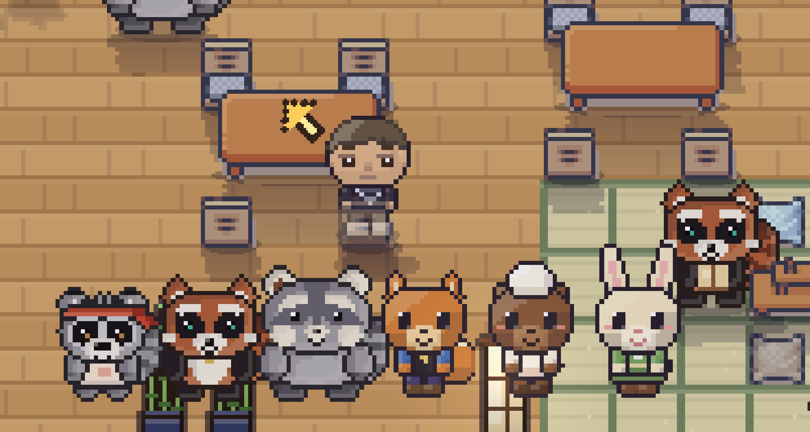
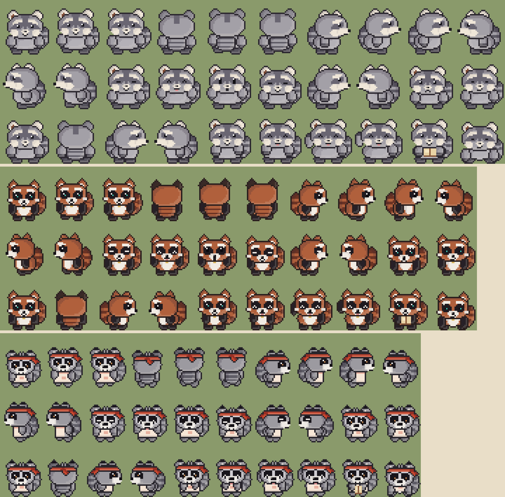

# Los tres mapaches: Pip, Rigg y Spicy Bacon

30/10/2026. Los tres mapaches se rehicieron desde cero a partir de las fotos de los
peluches, parados en dos patas. Se dibujan por código (pixel art procedural), sin
PNG: `src/art/trio.ts`. Reemplaza al generador anterior (`plush` en los specs), al
Pip erguido de `art/pip.ts` y a la hoja ilustrada de Rigg, que se borraron.

## Cada uno
| | Cuadro | Rasgos |
|---|---|---|
| **Pip** (el más grande) | 36×39 | Gris, franja oscura en la frente, orejas crema, panza grande. De frente el hocico es una puntita (casi no se ve la nariz); de costado sí se ve el hocico largo. |
| **Rigg** (ella, naranja) | 34×39 | Pelaje óxido, manchas y patas negras, cejas blancas, pestañas, brillo verde agua en los ojos, medalla dorada. |
| **Spicy Bacon** (el más chico, juguetón) | 30×39 | Manchas grandes con aro claro, ojos marrones brillantes, mechones negros en las orejas, vincha roja atada (nudo y puntas) y delantal. Al caminar salta un poco más. |

El alto del cuadro (39) y la línea de los pies no cambian; el ancho extra es la cola,
que se ve en las cuatro direcciones.

## Cómo está armado
- `trio.ts` tiene un `LOOKS` por personaje (tamaños, paleta, accesorios) y una sola
  función de dibujo, `trioFrame(id, pose, custom)`. `folk.ts` la llama para `pip`,
  `rigg` y `spicy`; el resto de los personajes no cambia.
- Las piezas básicas (elipses, sombreado por bordes, cola con anillos, contorno de
  1 px por capa, espejo) están en `src/art/plushRaccoon.ts`.
- Respeta el contrato de las hojas de personajes: 30 cuadros en el orden de `FRAMES`
  (`characters.ts`): caminar en 4 direcciones, parpadeos, feliz, sorprendido, dormido,
  triste, orgulloso, respirar, cocinar, saludar, leer y sentado. La izquierda es el
  espejo de la derecha.
- El sombrero y la ropa que el jugador presta en el armario se siguen dibujando
  encima (reemplazan la vincha y el delantal de Spicy).
- Los guardados no cambian: mismos IDs y misma hoja de 30 cuadros.

## Cómo se verifica
`e2e/raccoon-sprites.spec.ts` corre una vez por mapache en un navegador real: tamaño
de la hoja, pies en las últimas filas, perfil izquierdo = espejo del derecho, cabeza
simétrica de frente (salvo Spicy, por el nudo de la vincha), ojos iguales a los dos
lados, sin ojos de espalda, cola visible en todas las direcciones y que caminar,
estados de ánimo y acciones sean cuadros distintos.
