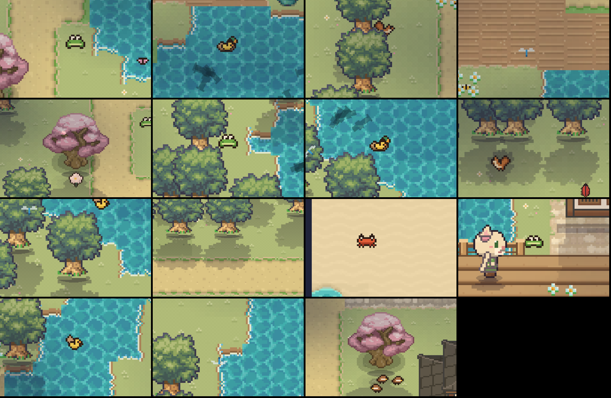

# Mundo vivo: detalles que se mueven solos

Todo esto es dibujo y sonido: no cambia reglas, guardados ni IDs. Con el modo batería o el movimiento reducido no se mueve nada
(las flores no se doblan, no hay pájaros ni estrellas ni arcoíris). Lo que se agregó ahora se suma a lo que ya había (mariposas,
luciérnagas, pétalos y hojas que caen, humo de chimeneas, polillas en los faroles, nubes que proyectan sombra, bandadas posadas,
faroles que se encienden de a uno, charcos que crecen con la lluvia). Ver también [zonas vecinas y peces](zonas-vecinas.md).

| Detalle | Cuándo | Dónde está |
|---|---|---|
| **Estrella fugaz** | De noche, sin lluvia, cada 22 a 70 s | `skyLife.ts` |
| **Arcoíris** (seis bandas, aparece 4 s, se queda ~66 s y se va en 8 s) | Cuando la lluvia termina de día (mañana o tarde) | `skyLife.ts`, disparado desde `WorldScene.update` |
| **Flores, arbustos y juncos que se doblan al pasar** | Cuando Sofi camina a menos de ~13 px; cada planta una vez cada 0,7 s | `WorldScene.updateSway` |
| **Reflejos en los charcos** | De día reflejan el cielo con destellos; con los faroles encendidos (también con lluvia) toman el color de la lámpara más cercana | `src/scenes/rainFx.ts` |
| **Campana del reloj de la estación** | A cada hora del juego; suena tantas veces como la hora en un reloj de 12 horas, con un máximo de 6 campanadas para que no se haga largo; fuerte en la estación, tenue en las calles de al lado, nada en el resto | `WorldScene.updateSky`, `audio.ts` (`clock_bell`) |

Los números (esperas, envolvente del arcoíris, campanadas, volumen de la campana) están en `src/scenes/skyMath.ts`, con sus tests
en `src/tests/skyMath.test.ts`.

## Límites conocidos
- La campana no se puede oír en una captura: la probé por lógica (tests), no con los oídos. Vale la pena escucharla en la estación.
- Los pájaros que cruzaban volando se sacaron (eran una V poco convincente). Los que vuelan son las bandadas posadas de siempre, ver más abajo.
- El arcoíris está anclado a la pantalla, no al mapa: cuelga siempre del mismo sector del cielo aunque camines.
- No hay "faroles que se prenden de a uno" nuevos: ya existía (cada farol tiene su propio momento de encendido).

## Bandadas posadas (palomas, gaviotas, gorriones)
Ya existían: saltan por el suelo y despegan juntas si Sofi se acerca a menos de 28 px. Ahora además:
- **Se asustan también cuando pasa alguien caminando** (un vecino, un personaje, el personal) a menos de 24 px. Quien está quieto al lado, o dormido, no las molesta: es el pasar lo que las espanta.
- **Vuelven:** a los 40 a 90 s bajan desde arriba y se posan donde estaban. Si hay alguien parado en ese lugar, esperan unos segundos más.
- **De vez en cuando despegan solas** (cada 45 a 125 s la primera vez y cada 70 a 160 s después), pero solo si están a la vista.

## Animales hechos por código (`src/scenes/wildlife.ts`, arte en `wildlifeArt.ts`)

Dibujados como los pajaritos: filas de letras por color con contorno oscuro. Nada bloquea ni se guarda. En modo batería o con
movimiento reducido no aparecen.

| Animal | Dónde | Qué hace | Cuando alguien se acerca (Sofi, o alguien que pasa caminando) |
|---|---|---|---|
| **Ranas** (hasta 3) | En la orilla de estanques y ríos (agua dulce), nunca sobre un puente; no en invierno | Croan inflando la garganta (con sonido, más seguido con lluvia y al atardecer) y saltan por la orilla | Saltan al agua con un anillo y un *plop*; a los 8-15 s vuelven a la orilla |
| **Pata con 2 a 4 patitos** | En agua dulce con lugar para nadar (agua alrededor), de día y al atardecer | Nadan en fila con la cabeza que sube y baja, dejan estela, ella mete la cabeza en el agua | Nadan hacia el lado contrario, más rápido |
| **Cangrejos** (hasta 4) | En la arena de la playa, cerca del agua | Caminan de costado y se paran | Se entierran (quedan los ojos) con un poco de arena; salen después |
| **Ardillas** (hasta 2) | Junto a los árboles del bosque, el bosque profundo, el jardín y el santuario; de día, no en invierno | Corren a buscar comida cerca de su árbol y se sientan a mordisquear | Corren al árbol y trepan hasta desaparecer; bajan a los 10-18 s |
| **Libélulas** (hasta 3) | Sobre el borde del agua dulce; primavera y verano, de día, sin lluvia | Flotan y salen disparadas a otro punto cercano | Se alejan |
| **Abejas** (hasta 4) | Alrededor de las flores; primavera y verano, de día, sin lluvia | Revolotean de flor en flor | Se alejan un poco |

La rana de imagen fija que había en el jardín (de un pack) se sacó: ahora es esta, animada.

## Pétalos y hojas que caen de los árboles
Antes salían del borde superior del mapa y no llegaban a verse. Ahora caen **de cada árbol que está a la vista**: se mecen, dan
vueltas, quedan unos segundos en el suelo y se desvanecen. Como mucho 48 a la vez.
- **Primavera:** pétalos rosas de los cerezos (1 o 2 por segundo por cerezo).
- **Verano:** alguna hoja verde de los árboles.
- **Otoño:** hojas naranjas, rojas y amarillas de los árboles y los cerezos (además del viento de hojas que ya había).
- **Invierno:** nada (está la nieve). Los pinos nunca sueltan nada.
