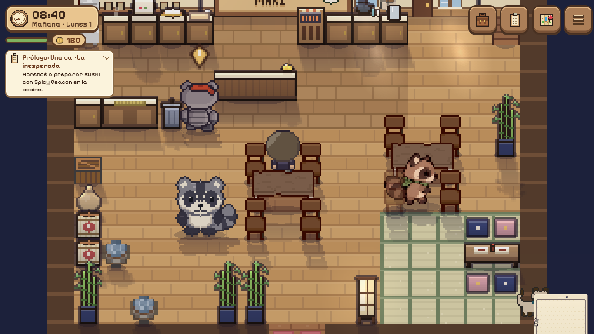
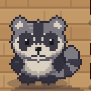

# Pip por código — prueba erguida (29/10/2026)

Diseño nuevo en `src/art/pip.ts`, dibujado desde cero con formas en una grilla
de píxeles. La foto del peluche guía el pelaje gris, las patitas oscuras, orejas
claras, antifaz, hocico crema y la franja central. Por indicación del usuario,
Pip está **parado en dos patas**, con cuerpo redondo y brazos independientes.
No se utiliza una imagen generada ni se cambia a Rigg o Spicy.

La hoja se genera una vez por apariencia, no por cuadro de juego: 66 cuadros de
48×39 px, con los 30 slots compartidos, 32 pasos (ocho por dirección), dos
parpadeos adicionales de lectura/asiento, conversación y una pose curiosa.
La altura visible es comparable con los NPC; el ancho incluye la cola.

Las patas avanzan y levantan alternativamente; brazos y cola acompañan el paso.
La cabeza conserva su altura y se desactiva el rebote adicional de Actor solo
para esta textura. Respiración por expansión del torso, parpadeo, sonrisa,
saludo, lectura, preparación, conversación, asiento y descanso con ojos cerrados.
No hay un segundo reloj ni cambios en rutas, velocidad, recepcionista, guardados
o reglas de juego. Se conservan los accesorios y el retrato usa el nuevo dibujo.

La selección de texturas está en `scenes/textures.ts`; `folkFrame` usa el mismo
dibujo para retratos. El generador anterior se conserva para los demás mapaches.

Verificación acotada: typecheck/build y solo la prueba nueva de Pip en
`e2e/pip-sprite.spec.ts` (hoja completa, diferencia de parpadeo limitada a ojos,
contacto de pies, diversidad del paso y accesorios). Se adapta la cobertura
anterior de Pip al generador nuevo; las pruebas de los otros mapaches quedan.
Playwright con `/?debug`, `mmDebug` y `perf: 'high'`: llegada de partida nueva,
capturas de las cuatro caminatas y varias acciones en el restaurante, PC y vista
vertical emulada; sin errores JavaScript observados. Poses aisladas con debug en
una partida descartable. No suite completa, teléfono físico ni recorrido de todas
las rutinas nocturnas. Las muestras animadas recortan capturas del juego; el ciclo
se muestra en un punto fijo para comparar los pasos, no como prueba de una ruta.

Es una propuesta para comparar estilos: la preferencia visual queda a evaluación
del usuario. Descanso representa a Pip quieto con ojos cerrados; no se añadió
una animación de acostarse. Picardía reutiliza la expresión neutral.
