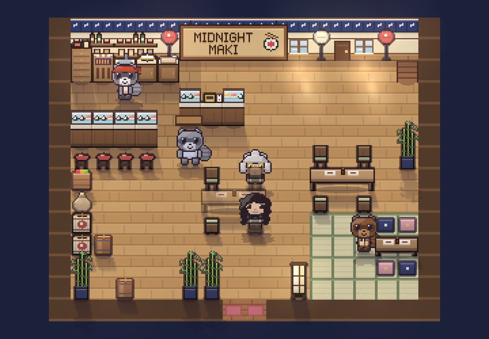
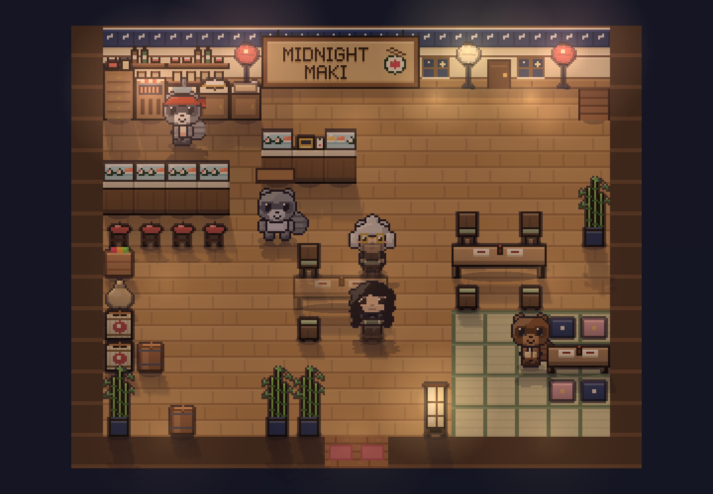
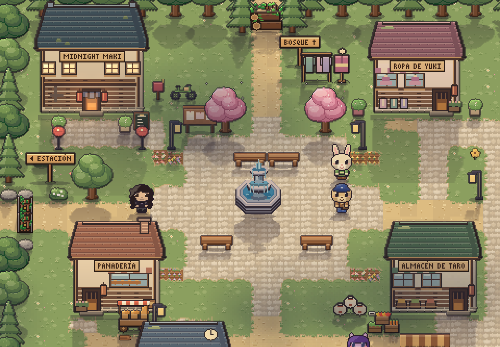
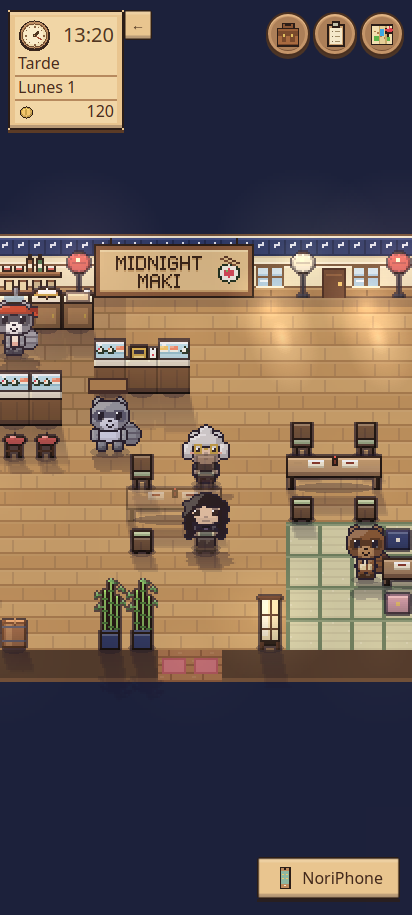

# Prueba visual: base C con detalles de A

Rama de prueba: `prueba/cozy-c-con-detalles-a`.
Respaldo previo: `respaldo/antes-cozy-ca-2026-10-16`, en el commit `1d97d328ddac6dbafd6af9a30aeb6a7bc789bdd7`.

La prueba aclara el restaurante y simplifica superficies para acercarlo a la propuesta C. Conserva los mostradores de sushi, la vitrina, el konro, el hangiri, las estanterías, el cartel y los faroles japoneses de A. Se implementa con el arte procedural original del proyecto; no incorpora las ilustraciones generadas ni publica los packs descargados.

- Paredes de yeso crema con zócalo de madera y noren índigo.
- Suelo de miel con tablas más amplias y menos marcas; cocina ligeramente más oscura y tatami salvia.
- Encimeras crema y frentes de madera media; mesas más claras, sillas de nogal con asiento salvia y menos líneas en los respaldos.
- Césped y follaje menos saturados, con menos motas y mechones; los caminos conservan su trazo.
- El restaurante conserva una luz nocturna cálida y una viñeta más suave; la calle mantiene su noche azul y las ventanas y faroles siguen sus horarios.

Se mantienen IDs, huellas, posiciones, colisiones, personajes, poses, progresión, decoración de partidas existentes y mecánicas. La prueba no rediseña la distribución para copiar la imagen conceptual: estas son capturas del juego real.

## Capturas reales

[Abrir la comparación antes/después](art/cozy-ca/comparacion.html).

Las imágenes de revisión se guardan en `docs/art/cozy-ca/`. Las tomas del salón usan una cámara de revisión de zoom entero para mostrar la habitación completa; la captura móvil utiliza el encuadre normal del juego. No se añade un nuevo modo de cámara al producto. Las capturas anteriores usan movimiento reducido y las nuevas los efectos habituales; los halos, las sombras de nubes y las posiciones de los NPC pueden variar entre tomas.

### Restaurante de día



### Restaurante de noche



### Plaza



### Móvil



## Verificación

- `npm run build`: TypeScript y bundle de producción correctos; Vite conserva los avisos existentes sobre imports dinámicos/estáticos compartidos.
- `npm test -- --no-cache`: 63 archivos, 466 pruebas correctas, incluidas dos nuevas comprobaciones de calidez/legibilidad y continuidad del anochecer en el restaurante.
- Pruebas de navegador de `e2e/light.spec.ts`: día, atardecer, noche, lluvia y horarios del restaurante.
- Revisión de cinco escenas en escritorio/móvil con Chromium, sin errores de JavaScript.

## Probar y volver atrás

Para ejecutar esta variante:

```sh
git switch prueba/cozy-c-con-detalles-a
npm run dev
```

Para recuperar el estado previo sin borrar la prueba:

```sh
git switch respaldo/antes-cozy-ca-2026-10-16
npm run dev
```

Las ramas son alternativas de código. No hay migración de formato de guardado; probar con una partida de ensayo permite comparar sin modificar el progreso de una partida habitual.
