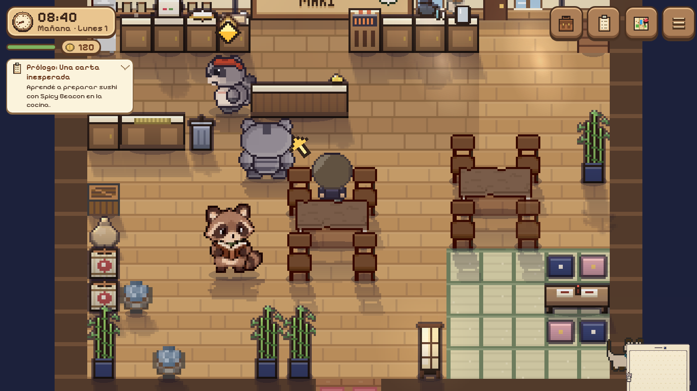
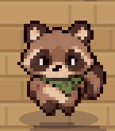
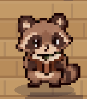

# Rigg: primera prueba con sprites ilustrados

29/10/2026. El diseño elegido en el chat se usa para Rigg, sin cambiar a Pip ni a Spicy.
Verificación repetida después de integrar los avances remotos hasta `fb7fd41`:
se conservan el nuevo generador de peluches para Pip/Spicy y las mejoras de cocina.

- Fuente editable: `src/assets/characters/rigg-source.png` (una hoja con 24 poses).
- Archivo que carga el juego: `src/assets/characters/rigg.png`, 36 cuadros de 40×39 px.
  Los primeros 30 conservan el contrato compartido; seis extras completan las
  caminatas y los parpadeos de lectura y asiento.
- Regenerar con `python scripts/build-rigg-assets.py` (Pillow, como los demás builders).
  Se separan las 24 siluetas antes de alinearlas: la imagen generada cruza ligeramente
  los límites nominales de las celdas. Escala común, pies alineados, alpha binario y
  remuestreo nearest-neighbor; no se recorta una parte de la pose vecina.
- `BootScene` precarga la hoja; `riggSprite.ts` contiene la selección y dimensiones.
  `charTexture` y su consulta de caché reutilizan la textura cargada.
- Sin cambios en guardados, historia, movimiento, rutinas ni colisiones.
- Si la hoja no se carga, se conserva el renderer existente. Los atuendos distintos
  del habitual también usan ese renderer; volver al habitual recupera el sprite.

Es una primera adaptación, no un set completo de expresiones: sorpresa, tristeza
y picardía reutilizan poses neutrales. Trabajo usa las poses del
libro. Para dormir se usa descanso con ojos cerrados, compatible con el recorte de
la cama; las dos poses enrolladas quedan disponibles en la fuente para otra entrega.
El retrato de diálogo existente no se reemplaza.

Verificación acotada: typecheck y build; comprobación de dimensiones, transparencia
y márgenes de los 30 cuadros. Playwright Chromium con `/?debug` y `perf: 'high'`:
partida nueva y encuentro automático de llegada, textura de Rigg en restaurante,
selección de cuadros en cuatro direcciones, poses de lectura/saludo/descanso y
cambio/restablecimiento de atuendo. Poses aisladas mediante debug en partida
descartable, sin editar flags de historia. Capturas inspeccionadas en 1366×768 y
412×915; sin errores JavaScript en esas ejecuciones. No se ejecutó la suite completa
ni se probó en teléfono físico o durante toda una jornada de rutinas.

Capturas locales: `/workspace/exports/rigg-sprites/` (no se incluyen en el despliegue).
Build conserva avisos previos de un `case 'bell'` duplicado y módulos con imports
estáticos/dinámicos; ajenos a esta adaptación.

## Corrección de parpadeo y saltitos (29/10/2026)

La primera entrega duplicaba las poses abiertas en los slots de parpadeo. Además,
se seguía aplicando el rebote de las poses generadas, se repetía el primer cuadro
al caminar y la anchura de la cola influía en el centrado de cada silueta.

- Párpados recortados de la pose de ojos cerrados de la misma hoja: solo cambian
  los píxeles de los ojos. Parpadeo de frente, perfiles, leyendo y sentada; el
  cuerpo mantiene la misma posición al cerrar los ojos.
- Cuatro pasos reales por dirección, a seis cuadros por segundo; misma altura,
  línea de apoyo y alineación de cabeza dentro de cada secuencia.
- Perfil de movimiento exclusivo de la textura ilustrada: sin rebote adicional
  al leer/sentarse, sin pasos al trabajar mirando hacia arriba y sin saludo
  repetido durante toda una conversación. Los otros personajes y el renderer de
  atuendos personalizados mantienen su comportamiento.
- Sin campos nuevos ni cambios de rutinas, rutas, velocidad o guardados.

Verificación: tres tests puntuales en `src/tests/riggMotion.test.ts`, typecheck y
build. Comparación de píxeles de las cinco parejas de parpadeo (misma silueta,
cambios limitados a ojos) y altura común en las cuatro caminatas. Playwright con
`perf: 'high'`: temporizador real de `Actor.update` para abrir/cerrar los ojos al
leer, selección de los 16 pasos, posición vertical y rebote constantes; capturas
inspeccionadas en PC y vista vertical emulada, sin errores JavaScript. No suite
completa ni prueba en teléfono físico.

Las siguientes muestras recortan capturas del juego; la caminata muestra el ciclo
en un punto fijo para comparar la alineación, sin representar un recorrido:

