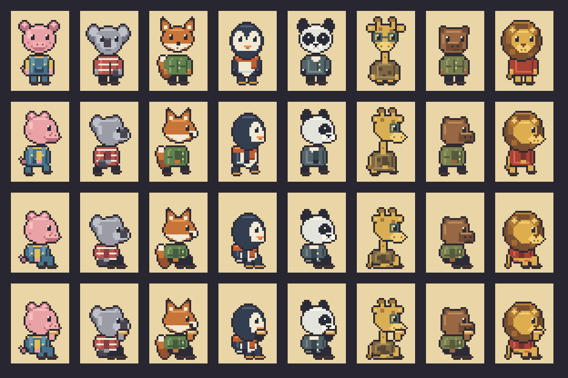

# Clientes de 28×40

Ocho personajes independientes, sin cargar en escenas ni modificar el juego:

| ID | Nombre | Especie | Hoja de animación | Vista frontal |
| --- | --- | --- | --- | --- |
| oli | Oli | Cerdito | [oli.png](oli.png) | [oli-idle.png](oli-idle.png) |
| toby | Toby | Koala | [toby.png](toby.png) | [toby-idle.png](toby-idle.png) |
| fredi | Fredi | Zorro | [fredi.png](fredi.png) | [fredi-idle.png](fredi-idle.png) |
| pipo | Pipo | Pingüino | [pipo.png](pipo.png) | [pipo-idle.png](pipo-idle.png) |
| po | Po | Panda | [po.png](po.png) | [po-idle.png](po-idle.png) |
| gigi | Gigi | Jirafa | [gigi.png](gigi.png) | [gigi-idle.png](gigi-idle.png) |
| nico | Nico | Capibara | [nico.png](nico.png) | [nico-idle.png](nico-idle.png) |
| leo | Leo | León | [leo.png](leo.png) | [leo-idle.png](leo-idle.png) |

Cada hoja tiene 14 cuadros horizontales de **28×40**, con tamaño total de
**392×40**, transparencia y píxeles sin suavizado. Los PNG frontales miden
28×40. El tamaño es propio de estos recursos: no reemplaza el de los personajes
existentes ni presupone que sus animaciones usen los mismos índices.

## Animaciones

| Animación | Cuadros | Velocidad | Acción |
| --- | --- | --- | --- |
| idle | 0, 0, 0, 0, 1, 0 | 3 fps | Esperar y parpadear, de frente |
| idleSide | 2, 2, 2, 2, 3, 2 | 3 fps | Esperar y parpadear, de perfil |
| walk | 4, 5, 6, 7 | 7 fps | Caminar |
| sit | 8, 9 | 1.5 fps | Sentado, respirar y parpadear |
| eat | 10, 11, 12, 13 | 3 fps | Comer sentado |

Todas las secuencias se repiten. Las vistas de perfil miran a la derecha;
usar `flipX` para mirar a la izquierda. Origen sugerido: `(0.5, 1)`.
Las poses sentadas no incluyen mesa, silla ni banco.

El manifiesto [animations.json](animations.json) contiene los tamaños,
las secuencias y la lista de personajes. El generador procedural está en
[src/art/customers.ts](../../art/customers.ts), con su lienzo de píxeles
en [src/art/pixbuf.ts](../../art/pixbuf.ts). No requiere nuevas dependencias.

## Vista previa

Columnas: Oli, Toby, Fredi, Pipo, Po, Gigi, Nico y Leo.
Filas: frente, caminar, sentado y comer. La vista está ampliada 3×.

